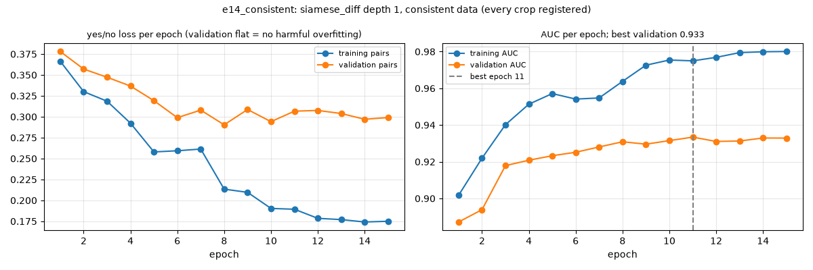
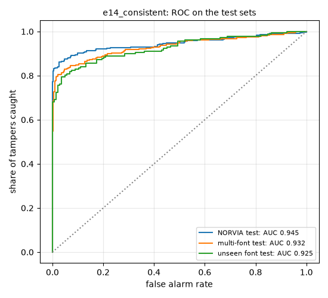

# Final model `e14_consistent`: every setting used

All values below are read from the code and from the run's own files (`outputs/exp007/e14_consistent/config.json`, `metrics.json`), not from memory. The model, its data and its results are described in [EXP-014](../experiments/EXP-014_consistent_dataset.md).

## 1. Data (`data/synth_v2`, made by `src/exp013_make_data.py` + `src/synth.py`)

| Setting | Value |
|---|---|
| Samples generated | 10 000: 5 000 NORVIA (D2) + 5 000 made-up words in other fonts (D1); half genuine, half tampered |
| Fonts (all bold) | NORVIA: DejaVu Sans. D1, 8 training fonts: DejaVu Sans, Liberation Sans, Ubuntu, Noto Sans (two versions), Open Sans, Roboto, PT Sans; **Lato only in the unseen-font test** |
| Tamper types (take turns) | stretch 1-8 % (whole logo 40 %, one part 60 %); recolour hue 3-15°; re-spacing one letter 1-6 px; letter swap (other font or look-alike, e.g. O→0); font swap (whole word); overlapping text (cap height 14-28 px); cut-off (8-45 % of the logo outside the photo) |
| Virtual camera | yaw N(0, 14°) clipped ±35°, pitch N(0, 10°) clipped ±28°, roll ±10°, focal 0.8-1.3 × image size, logo 380-1000 px wide |
| Photo effects | brightness gradient across the photo (up to 12 % from one side to the other); blur in 50 % of photos (Gaussian σ 0.4-1.6, or motion blur 5-12 px in 15 % of those); sensor noise σ 0-0.012; colour cast ×0.94-1.06 per channel and brightness ×0.9-1.08 |
| Photo finish | rendered square, resized to 960×1280 (50 %), 1280×960 or 1024×1024 (25 % each), like the real photos; JPEG quality 78-96; image border filled by repeating the edge (no mirrored logos) |
| Aligned | 9 885 of 10 000 (the rest: logo not found, no crop) |
| Split rule | each sample at random: 70 % train / 15 % validation / 15 % test; Lato samples go to the unseen-font test only |
| Pairs used | **train 6 770**, validation 1 427, test: NORVIA 710, other fonts 653, unseen font 325 |

## 2. Alignment of the tampered image (EXP-001 code, the same for synthetic and real photos)

| Step | Value |
|---|---|
| Template | logo crop of `ref_1.jpg`, box (140, 220)-(1060, 480) = 920×260 px |
| Pre-processing | grey, then CLAHE (clip limit 2.0, tiles 8×8) |
| Keypoints | SIFT, up to 5 000 per image |
| Matching | brute force (L2), 2 nearest neighbours, Lowe ratio test 0.75, then at most one partner per photo keypoint |
| Transform | RANSAC homography, reprojection threshold 4 px (OpenCV defaults: up to 2 000 iterations, confidence 0.995) |
| Sanity check | ≥ 15 inliers; the found outline is convex; its area is 0.05-20 × the template's |
| Fine-tuning | ECC, homography motion, 100 iterations or change < 1e-6, Gaussian pre-filter 5, mask = pixels inside the photo (eroded 5×5) |
| Output | photo warped onto the 920×260 reference frame |
| Cut-off flag | > 1 % of the reference's green ink falls outside the photo |
| Seeds | fixed (`common.fix_seeds`, seed 0); a re-run gives byte-identical crops |

## 3. Model input

| Setting | Value |
|---|---|
| Inputs | reference crop and aligned tampered crop |
| Resize | 920×260 → 460×130 → **448×128** (area interpolation), RGB |
| Normalisation | ÷255, then ImageNet mean (0.485, 0.456, 0.406) and std (0.229, 0.224, 0.225) |

## 4. Architecture (`src/models.py`, `SiameseDiff`, depth 1)

| Part | Value | Output size |
|---|---|---|
| Encoder (shared by both inputs) | ResNet-18 pre-trained on ImageNet: conv 7×7 stride 2 + BatchNorm + ReLU + max-pool + stage 1 (2 residual blocks) | 64 × 32 × 112 |
| Comparison | concatenate \|ref − tampered\| and ref × tampered | 128 × 32 × 112 |
| Comparison block | conv 3×3 (128) + BatchNorm + ReLU; conv 3×3 stride 2 (128) + BatchNorm + ReLU | 128 × 16 × 56 |
| Pooling | global max + global mean, concatenated | 256 |
| Dropout | 0 (none) | |
| Output 1 "tampered?" | linear 256 → 1 (logit; sigmoid gives p) | 1 |
| Output 2 "which tamper?" | linear 256 → 8 (none + 7 types; softmax gives probabilities) | 8 |
| Heatmap (for display only) | mean over channels of \|enc(ref) − enc(tampered)\| | 32 × 112 |
| Trainable weights | **455 497**; nothing frozen | |

## 5. Training (`src/train_pairs.py`, run `e14_consistent`)

| Setting | Value |
|---|---|
| Loss | **binary cross-entropy** on output 1 + **0.3 × cross-entropy** on output 2 (8 classes) |
| Not used | focal loss, label smoothing, class weights |
| Optimiser | **AdamW**, learning rate **3e-4**, weight decay **1e-4** (all weights), betas (0.9, 0.999), eps 1e-8 |
| Learning-rate schedule | cosine decay from 3e-4 to 0 over all 3 180 steps (212 per epoch), no warm-up |
| Batch size | 32, shuffled every epoch |
| Epochs | 15 |
| Precision | mixed (float16 autocast + gradient scaling) on the GPU |
| Augmentation during training | none extra: the camera and photo effects come from the generator. Colour, shift and stretch augmentations are deliberately not used, because they look exactly like tampers |
| Initialisation | ImageNet weights for the encoder; PyTorch defaults for the new layers |
| Seed | 0 |
| Model selection | the epoch with the best **validation AUC**: epoch 11 (0.933). Test sets are never used to choose |
| Hardware and time | NVIDIA RTX A2000 Laptop (4 GB); ~20 s per epoch, ~5 min in total; peak GPU memory 2.2 GB |

## 6. Decision thresholds (from the validation set only)

| Band | Rule | Value |
|---|---|---|
| Tampered | p ≥ 95th percentile of the genuine validation scores (5 % of genuine pairs flagged) | **0.493** |
| Genuine | p ≤ 5th percentile of the tampered validation scores (95 % of tampers score above) | **0.053** |
| Don't know | in between | |
| Real photos | p = mean over the 3 references; a cut-off logo is flagged as not genuine; a photo that cannot be aligned is "can't verify" | |

**Confidence shown with each decision:** how often that band was right on the 1 688 labelled test pairs (about half tampered), from `submission/scripts/evaluate_onnx.py --save-confidence` (`submission/model/confidence.json`):

| Band | Share of test pairs | How often right |
|---|---|---|
| TAMPERED | 43 % (729) | 94.9 % really tampered |
| GENUINE | 25 % (423) | 92.0 % really genuine |
| DON'T KNOW | 32 % (536) | no call; 20.0 % of these were tampered |

Also shown: whether the 3 references agree on p, and how many independent methods (difference map, colour, cut-off) agree. p itself is not calibrated (test pairs with p 0.8-0.95: 85 % tampered; p 0.2-0.49: 34 %). The rates come from synthetic data with about half tampered, so on real photos they are a guide.

## 7. Evaluation metrics

| Metric | What it measures | Where |
|---|---|---|
| **ROC AUC** | chance that a random tampered pair scores above a random genuine one; needs no threshold | every split, every epoch |
| **False-alarm rate** | share of genuine pairs flagged at the "tampered" threshold | test sets |
| **Catch rate per tamper type** | share of each tamper type flagged at the same threshold | test sets |
| "Which tamper?" accuracy | share of tampered pairs whose type output 2 names correctly | test sets |
| Training vs validation AUC and loss per epoch | overfitting check | [training curve](../outputs/exp014/evidence/training_curve.png) |
| Agreement between independent methods | real photos (no ground truth): model vs difference map, colour check, cut-off measure | `outputs/final/final_results.csv` |

Accuracy at p = 0.5 is logged too, but not used: the decision uses the thresholds above.

## 8. Results with these settings

| Test set | Pairs | AUC | False alarms | Caught | Type named right |
|---|---|---|---|---|---|
| NORVIA, shared with earlier models | 105 genuine / 101 tampered | **0.959** | 3/105 (2.9 %) | 84/101 | – |
| NORVIA | 373 / 337 | 0.945 | 16/373 (4.3 %) | 291/337 | 85 % |
| Other fonts | 338 / 315 | 0.932 | 15/338 (4.4 %) | 257/315 | 73 % |
| Unseen font (Lato) | 144 / 181 | 0.925 | 6/144 (4.2 %) | 144/181 | 73 % |

Training vs validation AUC at epoch 11: 0.975 vs 0.933 (gap 0.04); validation loss flat after epoch 6, so no harmful overfitting.

The ONNX export gives the same results on all these test pairs: largest difference in p 4e-6, no decision changed (`submission/model/onnx_check_full.md`).
